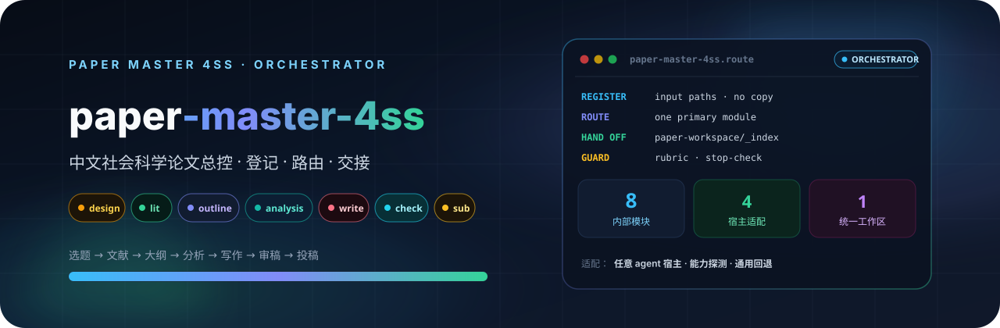

<p align="center">
  
</p>

# Paper Master 4SS

中文社会科学论文全流程总控工作流。用于登记任意位置的输入材料、判断当前所处阶段，并调度内部自包含模块（研究设计、文献综述、论文大纲、数据与质性分析、学术机制图、正文写作与润色、全文审稿检查、投稿整备），将所有产物统一归档至 `paper-workspace/`。

适用场景：明确当前论文阶段与下一步任务、整理分散的论文项目状态，或串联「设计—文献—大纲—分析—制图—写作—审稿—投稿」全流程。

## 4SS 家族

本仓库为各模块唯一的源仓库。九个业务模块既可内置于总控包统一使用，也可通过 `scripts/export_standalone.py` 导出为独立仓库单独安装（请勿直接修改独立导出仓库）。

| 模块包 | 职责 | 默认输出目录 |
|---|---|---|
| **[paper-master-4ss](https://github.com/JingYangYuan/paper-master-4ss)** | 输入登记、模块路由、索引维护与质量评分 | `paper-workspace/_index/` |
| [paper-design-4ss](https://github.com/JingYangYuan/paper-design-4ss) | 选题定位、理论框架路由与研究设计蓝图 | `01-design/` |
| [paper-lit-4ss](https://github.com/JingYangYuan/paper-lit-4ss) | 中英文检索、文献地图、空白识别与假设推导 | `02-literature/` |
| [paper-outline-4ss](https://github.com/JingYangYuan/paper-outline-4ss) | 材料扫描、大纲构建、证据映射与缺口报告 | `03-outline/` |
| [paper-analysis-4ss](https://github.com/JingYangYuan/paper-analysis-4ss) | 定量 / 质性 / 混合方法分析（Stata · R · Python） | `04-analysis/` |
| [paper-write-4ss](https://github.com/JingYangYuan/paper-write-4ss) | 章节起草、润色改写、语言扫描与正文净稿 | `05-writing/` |
| [paper-check-4ss](https://github.com/JingYangYuan/paper-check-4ss) | 全文审稿、交付前复核、问题矩阵与问题退回 | `05-writing/reviews/` |
| [paper-submission-4ss](https://github.com/JingYangYuan/paper-submission-4ss) | Word 导出、体例核查、投稿清单与说明信函 | `06-submission/` |
| [paper-mechanigraph-4ss](https://github.com/JingYangYuan/paper-mechanigraph-4ss) | 纯矢量学术机制图生成、拓扑匹配与渲染自检 | `paper-workspace/figures/` |
| [paper-update-4ss](https://github.com/JingYangYuan/paper-update-4ss) | 生成待人工审核的更新包，不直接修改核心文件 | `07-update/` |

标准用户流程：

```text
定位选题 -> 文献定位 -> 结构成型 -> 分析/材料验证（按需） -> 正文写作 -> 审稿复核 -> 投稿整备
```

仅当设计报告明确需要经验验证（`analysis_required: true`）时进入 `analysis`；理论、规范或阐释类研究从大纲直接进入写作。

## 安装与初始化

将本仓库放置于所用 Agent 软件的 skills 目录，入口文件为 `SKILL.md`：

```bash
git clone https://github.com/JingYangYuan/paper-master-4ss.git
```

在论文项目根目录首次使用时，初始化输出工作区：

```bash
mkdir -p paper-workspace/{00-meta,01-design,02-literature,03-outline,04-analysis,05-writing,05-writing/reviews,06-submission,07-update,figures,_logs,_logs/hook-audit,_index}
```

### 模块外部依赖

总控在路由前会检查目标模块的外部依赖（详见 `references/install-dependencies.md`），缺依赖时中止执行并提示安装：

| 模块 | 外部依赖 |
|---|---|
| design / outline / update / check | 无强制外部依赖 |
| lit | 检索 CNKI 须具备可见浏览器控制能力（`ego-browser`）；Zotero MCP 为可选增强 |
| analysis | 按选用语言配置 Stata / R / Python 环境（机器学习模式默认 Python） |
| write | Python 3（运行扫描与复杂度分析脚本） |
| mechanigraph | Python 3；Google Chrome / Chromium（用于无头渲染 PNG 自检，缺失时仍可生成 SVG） |
| submission | Python 3；`pandoc`（Word 导出）；`python-docx`、`lxml`（格式校验） |

## 工作机制

1. **能力探测**：读取 `references/runtime-adapter.md` §5，检测当前运行环境可用工具并映射为通用能力。
2. **路由与编排**：读取 `master/routing-matrix.md` 选定主模块，读取 `master/agent-orchestration.md` 确定顾问派发档位。运行环境不支持并行时，按相同角色清单顺序复核并记录 `sequential-review`。
3. **模块执行**：加载并执行 `modules/<module>/MODULE.md`。
4. **索引与评分**：更新 `_index/project-state.md`、`handoff-status.md`、`paper-roadmap.md`，并执行 `scripts/paper_master_guard.py score-project` 生成质量评分。

## 工作区索引文件

| 文件 | 维护内容 |
|---|---|
| `_index/project-state.md` | 研究主题、当前阶段、产物清单与缺口 |
| `_index/input-registry.md` | 外部输入路径登记（只登记不搬运） |
| `_index/handoff-status.md` | 阶段交接检查项与未解决风险 |
| `_index/paper-roadmap.md` | 论文全流程路径图与下一步建议 |
| `_index/quality-score.md` / `.json` | 阶段质量分、成熟度评分与失败归因 |

完整工作区约定见 `master/workspace-contract.md`。

## 运行环境适配与 Hook 注册

本包不绑定特定运行环境。每次启动按 `references/runtime-adapter.md` §5 探测实际可用工具并写入 `paper-workspace/_index/runtime-capabilities.md`；`references/agent-software-adapters.md` 提供常见工具形态与 hook 配置格式的对照参考。

包内不在 skill frontmatter 中声明 hooks。如需启用命令后及交付前自动审计，可使用通用注册脚本（配置向导将答案保存至 `.paper-master/host-profile.json`）：

```bash
python3 scripts/register_host_hooks.py --detect   # 列出含 hooks 键的候选 JSON 配置
python3 scripts/register_host_hooks.py --setup    # 交互式配置目标文件、事件格式与 matcher
python3 scripts/register_host_hooks.py --print    # 预览生成的配置片段
python3 scripts/register_host_hooks.py --check    # 查询当前注册状态
```

无论是否配置自动 hook，均可在命令后与交付前手动运行审计脚本（见 `references/hooks-and-evaluation.md` 第 4 节）。

## 导出独立模块包

修改任一模块、家族表、路由或核心协议后，须从本仓库根目录执行全量导出，并将本仓库与各独立仓库同步推送（各独立仓库的 `README.md` 共用同一份家族表，避免仅导出单个模块）：

```bash
python3 scripts/export_standalone.py            # 全量导出至同级 ../paper-*-4ss/
python3 scripts/export_standalone.py --check    # 校验已导出包内的路径引用
```

同步推送仓库：

```bash
python3 scripts/publish_family.py               # 推送全部 10 个仓库
python3 scripts/publish_family.py --dry-run
python3 scripts/publish_family.py lit
```

独立包中的 `master/` 与治理类 `references/` 为导出时的快照，跨模块引用仍指向同级目录中的 `paper-master-4ss/`。

## 仓库目录结构

```text
paper-master-4ss/
├── SKILL.md                 # 总控工作流入口
├── master/                  # 路由、顾问编排、输出、交接与工作区协议
├── modules/                 # 九个自包含业务模块
│   ├── design/
│   ├── lit/
│   ├── outline/
│   ├── analysis/
│   ├── write/
│   ├── check/
│   ├── submission/
│   ├── mechanigraph/
│   └── update/
├── references/              # 运行环境适配、依赖验收、评分标准、顾问注册表与公共块
├── scripts/                 # 审计脚本、hook 注册、独立包导出与发布脚本
└── docs/banner.svg
```

## License

[MIT](LICENSE)
