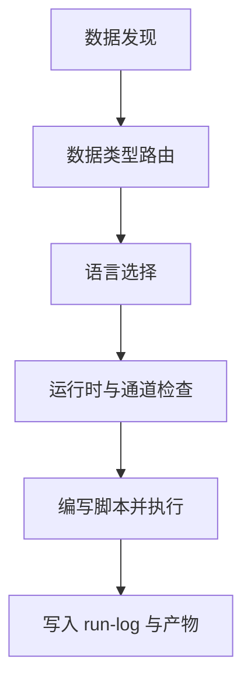
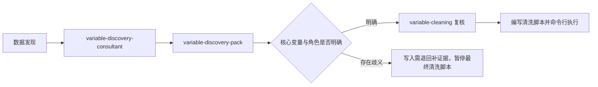

# Phase 01：初始化、环境核查与分析路由

本阶段文档、分析计划、过程日志与顾问综合报告均须遵守 `master/output-protocol.md`。数据发现、语言选择、执行检查与阶段路由须附 Mermaid 图及 2–4 条中文解释（说明数据来源、语言选择依据、执行阻断与不可声称边界）：



## 0. 顾问派发门控

完成数据发现与类型路由后，结构化数据任务须首先派发 `modules/analysis/agents/variable-discovery-consultant.md`，在单次派发中生成 `variable-discovery-pack-[YYYY-MM-DD].md` 的三段内容（字段清单、19 类变量角色映射、数据质量预判）。

仅当发现包确认核心变量与角色无歧义（或已将歧义显式列为「需退回补证据」）后，方派发 `modules/analysis/agents/variable-cleaning-consultant.md` 复核清洗方案、样本口径、缺失与异常值处理。若任务涉及回归建模、因果识别或面板/政策冲击，须进一步派发 `modules/analysis/agents/identification-consultant.md` 进行识别预判。顾问意见写入 `paper-workspace/_logs/agents/analysis-[YYYY-MM-DD]/` 并汇总至 `agent-synthesis-analysis-[YYYY-MM-DD].md`（无并行能力时记录 `sequential-review`）。



## 1. 目录与日志初始化

```bash
OUTPUT_ROOT="${OUTPUT_ROOT:-paper-workspace/04-analysis}"
mkdir -p "$OUTPUT_ROOT"/{data,scripts,tables,figures,reports,qual/codebooks,qual/coded-data,qual/memos,qual/anonymized,qual/reliability}
mkdir -p paper-workspace/_logs
LOG_FILE="paper-workspace/_logs/process-log-analysis-$(date +%Y-%m-%d).md"
if [ ! -f "$LOG_FILE" ]; then
  printf "# Process Log: modules/analysis\n\n| Time | Step | Decision | Output |\n|---|---|---|---|\n" > "$LOG_FILE"
fi
```

## 2. 数据文件发现

若用户未直接指定路径，先读取 `paper-workspace/_index/input-registry.md`，再扫描当前目录候选文件（按修改时间及 `clean`、`analysis`、`访谈`、`transcript`、`data`、`panel` 等文件名优先）：

```bash
test -f paper-workspace/_index/input-registry.md && sed -n '1,120p' paper-workspace/_index/input-registry.md
find . -maxdepth 4 -type f \( -name "*.csv" -o -name "*.xlsx" -o -name "*.dta" -o -name "*.sav" -o -name "*.rds" -o -name "*.parquet" -o -name "*.txt" -o -name "*.md" -o -name "*.docx" \) 2>/dev/null | head -80
```

## 3. 数据类型路由

| 输入形态 | 路由方向 |
|---|---|
| `.csv`/`.xlsx`/`.dta`/`.sav`/`.rds`/`.parquet` | 定量清洗与基础回归 |
| 多波次或含 `id`/`time` 字段 | 面板结构核查 + FE / RE / DiD 路径 |
| 访谈、田野笔记、开放题或政策文本 | 质性去标识化 + 编码 / 主题 / 内容分析 |
| 定量结果 + 质性材料 | 混合方法整合 |
| 高维非线性强、预测/分类目标或在识别框架内补强薄弱环节 | 机器学习与因果 ML（`phases/07-ml-and-causal-ml.md`） |

## 4. 分析语言选择与运行时检查

| 选择条件 | 默认语言 |
|---|---|
| 用户明确指定 | 用户指定语言 |
| `.dta` 数据、Stata 项目或要求 `esttab`/`putdocx` | Stata |
| 通用清洗、固定效应或常规回归表图 | R |
| 文本处理、批量编码或机器学习（`ml` 模式默认） | Python |

须在日志记录语言选择依据；若项目跨语言协作，须生成 `script-index.md` 说明执行顺序。`ml` 模式默认采用 Python（四个子流程全覆盖）；不得仅因某变量在 Stata 中有现成命令而切换至 Stata 运行 `ml`，除非项目约束明确要求仅以 Stata 交付。

**执行通道核查（编写脚本前必做）**：
- **Stata（`statamcp`）**：① 调用 `stata_session(action="list")` 检查 MCP 连接与会话；② 调用 `stata_run_selection` 执行 `display 1+1` 确认返回 `2` 并记入 `run-log`；未通过时按 `modules/analysis/references/stata-ecosystem-setup.md` §1 安装配置后再验。
- **R / Python**：

```bash
RUN_LOG="paper-workspace/04-analysis/reports/run-log-$(date +%Y-%m-%d).md"
mkdir -p paper-workspace/04-analysis/reports
case "$LANGUAGE" in
  r) command -v Rscript || echo "未找到 Rscript；见 modules/analysis/references/r-ecosystem-setup.md" ;;
  python) command -v python3 || echo "未找到 python3；见 modules/analysis/references/python-ecosystem-setup.md" ;;
esac
```

所有后续阶段产出的 `.do`/`.R`/`.py` 脚本须立即实际执行（Stata 经 `stata_run_file`，R/Python 经 `Rscript`/`python3`），并将调用方式、退出码、stdout/stderr 路径及产物写入 `run-log-[date].md`。无法执行时仅记录阻断原因，严禁输出虚构结果。

## 5. 数据安全边界

- **结构化数据**：仅在输出中呈现汇总统计量，不泄露原始行级敏感信息。
- **质性文本**：进入模型阅读或辅助编码前须先执行去标识化，不得读取、复制或输出真实身份映射表。

## 6. 最低启动条件

- **定量分析**：数据路径、因变量、核心自变量（控制变量、固定效应与聚类层级可从上游研究设计推断并记录）。
- **质性分析**：文本路径、研究问题、分析单位（仅整理材料时默认生成分段表与编码本草案）。
