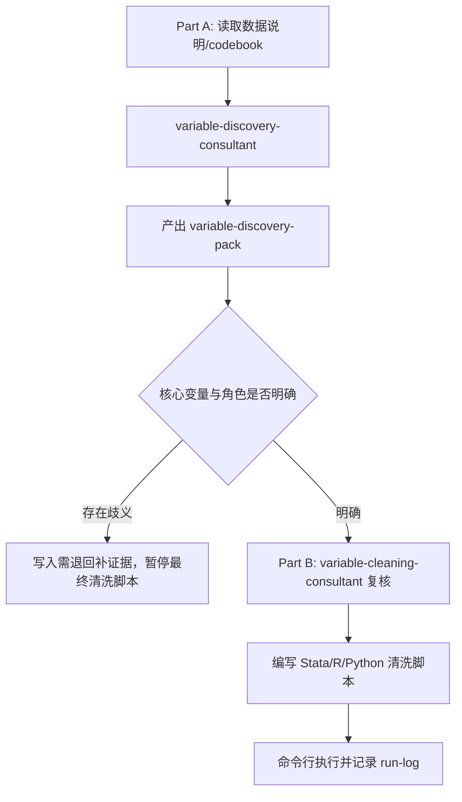

# Phase 02：定量数据清洗与描述统计

本阶段旨在构建可复现、可审计的论文分析数据集（不承接大型原始调查数据库的全库重构），分为 **Part A（变量发现）** 与 **Part B（清洗复核与执行）** 两步，顺序不可颠倒。



## 1. Part A：变量发现（生成 `variable-discovery-pack`）

读取数据结构、变量标签、codebook、问卷或已有变量字典后，派发 `modules/analysis/agents/variable-discovery-consultant.md`（输出写入 `paper-workspace/_logs/agents/analysis-[date]/`），在单次评审中输出变量发现包的全部三段：
1. **字段清单**：候选变量、原始标签/题项、来源路径、含义与疑点；
2. **角色映射**：覆盖 `Y/X/control/fe/cluster/weight/id/time/mechanism/mediator/moderator/heterogeneity/threshold/nonlinear/instrument/treatment/post/running/cutoff` 共 19 类角色及退回项；
3. **质量预判**：缺失率、特殊缺失码、异常值、单位混乱、反向题、重复记录、面板唯一性与样本口径风险。

主流程综合生成 `paper-workspace/04-analysis/reports/variable-discovery-pack-[date].md`，须包含 `## 参考库回查`、`## 候选变量清单`、`## 变量角色映射`、`## 数据质量预判`、`## 需退回补证据` 与 `## 进入清洗条件` 六节。

若发现包存在核心变量或角色歧义，须将其列入「需退回补证据」并暂停撰写最终清洗脚本（仅可交付发现包、退回项与探查脚本）；仅当数据路径、codebook 或问卷完全缺失且项目索引无记录时，请求用户补充最小材料。

## 2. Part B：清洗复核与脚本执行

### 2.1 清洗前置复核

将 `variable-discovery-pack-[date].md`、数据路径、研究问题、退回项处理情况与选用语言交由 `modules/analysis/agents/variable-cleaning-consultant.md` 复核，通过后方编写正式清洗脚本。

### 2.2 必查清单与常规清洗动作

- **八项必查**：文件读取与编码日志、核心变量存在性、数据类型表、缺失比例表、异常值/分位数诊断、ID 或 ID-time 重复值诊断、样本筛选流失表、`id-time` 唯一性与面板平衡性。
- **清洗规范**：保留原始变量名至变量字典并为清洗变量赋予可读名称；数值/日期类型规范化；显式转换特殊缺失码（如 `-8`、`-9`、`999`）并记录规则；异常值优先报告敏感性，缩尾/截尾须写明阈值；分类变量保留参照组与标签；按理论需要执行对数化、标准化或中心化；合成指数须统一分量方向并报告内部一致性（如 Cronbach α）或构造逻辑。

### 2.3 变量字典（`variable-dictionary.csv`）

所有进入模型的变量均须登记至 `paper-workspace/04-analysis/data/variable-dictionary.csv`，必填字段：
`raw_name`、`clean_name`、`display_name`（供导出表格、图轴与正文使用的可发表展示名）、`label`、`role`、`type`、`missing_rule`、`transform`、`source_file`、`notes`。

### 2.4 样本流失表（`sample-flow.csv`）

按可复现筛选步骤输出流失表（多分析样本时以 `sample_id` 区分或拆分为 `sample-flow-main.csv` / `sample-flow-robustness.csv`）：

| step | rule | n_before | n_after | dropped | reason |
|---|---|---:|---:|---:|---|
| 0 | 原始数据 | | | | 原始样本 |
| 1 | 保留合格研究对象 | | | | 研究对象界定 |
| 2 | 非缺失_因变量 | | | | 因变量缺失 |
| 3 | 非缺失_核心解释变量 | | | | 核心解释变量缺失 |
| 4 | 非缺失_控制变量 | | | | 控制变量缺失 |
| 5 | valid panel/id-time | | | | 面板唯一性筛选 |

### 2.5 描述统计与质量诊断

- **输出**：Table 1（均值、标准差、最小值、最大值、观测值 N；分类变量报告比例）、分组描述统计、相关矩阵（仅作描述不作因果依据）及分布/分组均值基础图。描述统计数值保留 3 位小数，样本量与频数保留整数。
- **清洗报告诊断**：说明核心变量缺失集中度、极端值成因、小样本分类合并需求、面板重复与不平衡程度、零/缺失权重处理，以及清洗是否改变样本主体结构。

### 2.6 三语言模板与强制执行

模板参考：`templates/02-clean-describe/cleaning.do`（Stata）、`modules/analysis/templates/_shared/r_common.R` 与 `templates/02-clean-describe/cleaning.R`（R）、`modules/analysis/templates/_shared/python_common.py` 与 `templates/02-clean-describe/cleaning.py`（Python）。

脚本编写完成后须立即实际运行，并将调用记录、退出码、stdout/stderr 路径与产物写进 `paper-workspace/04-analysis/reports/run-log-[date].md`：

```bash
# Stata: 调用 statamcp stata_run_file(file_path="paper-workspace/04-analysis/scripts/cleaning.do", working_dir=..., timeout=...)
# R:
Rscript "paper-workspace/04-analysis/scripts/cleaning.R"
# Python:
python3 "paper-workspace/04-analysis/scripts/cleaning.py"
```

未执行成功前，不得声称清洗完成或引用任何描述统计数值。

## 3. 输出文件清单

- `paper-workspace/04-analysis/data/analysis-data.*`
- `paper-workspace/04-analysis/data/variable-dictionary.csv`
- `paper-workspace/04-analysis/tables/table1-descriptives.*`
- `paper-workspace/04-analysis/tables/sample-flow.csv`
- `paper-workspace/04-analysis/reports/cleaning-report-[date].md`
