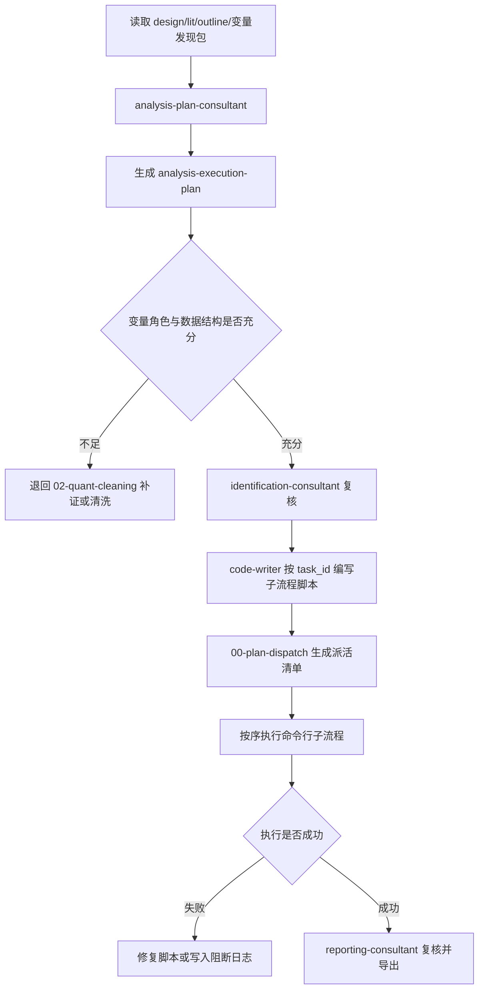

# Phase 03：模型执行、扩展检验与结果表

本阶段模型决策记录、分析执行计划、扩展检验说明与结果摘要须遵守 `master/output-protocol.md`。本阶段依据上游设计与变量发现包中的完整变量蓝图自动规划并执行全部设定环节，而非固定简化为「主回归 + 稳健性」。



## 0. 顾问派发门控

1. **制定执行计划**：派发 `modules/analysis/agents/analysis-plan-consultant.md` 读取 `01-design/`、`02-literature/`、`03-outline/`、`variable-discovery-pack-[date].md`、`variable-dictionary.csv` 与 `cleaning-report-[date].md`，抽取完整变量蓝图。
2. **模型与识别裁决**：派发 `modules/analysis/agents/identification-consultant.md` 复核模型设定与识别策略。
3. **代码编写（按 `task_id` 分族派发）**：

| 顾问文件 | 模板族 | 负责任务范围 |
|---|---|---|
| `modules/analysis/agents/code-writer.md` | 主回归族 | 描述统计、Table 1、基准模型、主回归与基础诊断 |
| `modules/analysis/agents/code-writer.md` | 机制扩展族 | 中介、机制、调节、异质性、门槛、非线性、交互、分组与边际效应图 |
| `modules/analysis/agents/code-writer.md` | 因果稳健族 | DiD、事件研究、IV、RDD、PSM/CEM/IPW、面板、稳健性与安慰剂 |
| `modules/analysis/agents/reporting-consultant.md` | 导出呈现 | CSV 宽表、图形、`script-index.md`、结果报告与导出脚本 |

4. **结果复核**：模型运行完成后派发 `identification-consultant` 与 `reporting-consultant` 复核结果边界。所有意见写入 `paper-workspace/_logs/agents/analysis-[YYYY-MM-DD]/` 并综合至 `agent-synthesis-analysis-[YYYY-MM-DD].md`（无并行能力时记录 `sequential-review`）。

## 1. 分析执行计划（硬入口）

未生成 `paper-workspace/04-analysis/reports/analysis-execution-plan-[date].md` 前不得撰写任何回归脚本。计划须使用中文 Markdown，包含以下六节：
- `## 来源回查`：已读取的 `design`、`lit`、`outline`、`analysis` 产物路径；
- `## 变量角色表`：全部 19 类角色归属；
- `## 假设与机制链`：上游假设（H1/H2…）、机制链与可检验路径；
- `## 模型执行任务表`：描述统计、主回归、机制/中介/调节/异质性/门槛/非线性、识别设计、稳健性与导出任务；
- `## 代码派活表`：各 `task_id` 的输入包、输出片段、合并位置与产物路径；
- `## 退回清洗项`：缺失变量、角色冲突、样本口径不清、数据结构不足或环境阻断。

信息不足时退回 `02-quant-cleaning.md` Part A/Part B 补证，不向用户抛回模型选择问题。

## 2. 模型路由与必执行范围

先读取 `modules/analysis/references/quantitative-model-router.md` 与 `quantitative-reporting-standards.md`。机制检验默认采用江艇（2022）两步法，调节效应默认四列递进规范，高维固定效应采用 `reghdfe`，工具变量采用 `ivreghdfe`（见 `quantitative-model-router.md` §11）。凡在变量蓝图中出现的机制、中介、调节、异质性、门槛、非线性、IV、DiD、RDD、面板或匹配角色，均须列入执行任务或明确记录不可执行阻断，不得笼统合并为「可选稳健性」。

## 2.5 因果识别前置诊断门（条件触发）

当研究设计命中 `references/quantitative-model-router.md` §12 分流表（DiD / IV / RD / 合成控制 / shift-share / 宽严度 / 可观测选择 / HTE / TMLE / 干扰 / 缺失数据）时触发（纯描述、无因果声称关联与质性路径不触发）：
1. **协议归类**：读取对应识别协议（DiD 九步 / IV 三阶段 / RDD 四阶段 / 合成控制八动作 / shift-share 两路径 / 宽严度五步 / 协变量三步）；
2. **填写识别包**：产出 `paper-workspace/04-analysis/reports/identification-protocol-pack-[date].md`，涵盖目标参数（精确估计量）、识别假设版本与制度论证、协议必做诊断清单、四条退出判据初判及结论适用范围；
3. **顾问裁决**：交 `paper-analysis-identification-consultant` 裁决，未获裁决前不得撰写 `model-decision`；
4. **退出判据处理**：识别包缺目标参数或假设版本时退回第 1 节重写计划；退出判据已触发时退回 `analysis-plan-consultant` 与设计层修改设计，严禁以更换更宽松估计量规避识别失败。

## 3. 模型决策记录

运行模型前在 `paper-workspace/04-analysis/reports/model-decision-[date].md` 逐块记录：来源设计、对应假设、变量角色、因变量类型、数据结构、模型选择（追溯至 `quantitative-model-router.md`）、标准误与聚类层级、固定效应与权重、诊断清单、可声称与不可声称内容、退回清洗项。

## 4. 子流程脚本组织与 CSV 宽表规范

按 `templates/03-regression/README.md` 划分脚本目录，执行顺序固定如下（`08-spatial` 编号靠后但在 `07-regression-export` 汇总导出前运行）：
1. `00-plan-dispatch`：生成 `model-decision-[date].md` 与 `regression-dispatch.json/csv`（不跑统计模型）；
2. `01-main-models`：描述统计、Table 1、OLS/基准模型、基础诊断与主回归；
3. `02-nonlinear`：Logit/Probit/Poisson/Tobit/Heckman/有序/多分类模型（输出边际效应或预测概率）；
4. `03-panel`：FE/RE、Hausman、双向固定效应、动态 GMM、面板 IV 与面板诊断；
5. `04-causal`：IV/2SLS/GMM、DID/事件研究、多期 DID、RDD、PSM/CEM/IPW、SCM；
6. `05-mechanism-heterogeneity`：中介、机制、调节、异质性、门槛、非线性、交互与分组检验（不并入稳健性）；
7. `06-robustness`：替代变量、替代样本、替代模型、标准误/聚类、安慰剂与敏感性检验；
8. `08-spatial`：空间权重矩阵、全局 Moran's I、截面与面板 SAR/SDM 及效应分解；
9. `07-regression-export`：汇总表格、图形、`script-index.md`、缺失产物报告与 `regression-results-[date].md`。

Stata 生产交付默认采用双总代码体系（`01_clean_and_prepare_master.do` + `02_empirical_analysis_master.do`，见 `MODULE.md` §4.2）；子流程模板用作模块化构建素材与并行拆分参考。脚本失败时直接报错并由主流程将退出码、错误信号与 stdout/stderr 路径记入 `run-log-[date].md`。

**CSV 论文宽表硬性要求**（默认写入 `tables/*.csv`，HTML/TeX/DOCX 仅作附加导出）：
- 第 1 行为中文表题（如 `表4基准回归`）；第 2 行为模型编号 `(1)`、`(2)`…；第 3 行为因变量名或模型标签；
- 核心变量、机制/调节变量与**全部控制变量逐行列报**，每变量两行（系数/边际效应及星号行 + 括号内 t/z 值行），不适用单元格填 `-`；模型特有参数（如 `cut1`、`常数`）保留为普通行；
- 固定效应用中文行名（如「省份固定」「年份固定」）汇总为「是/否」；表尾保留「观测值」，`R²` / `调整 R²` / `Pseudo R²` / `Within R²` 仅在适用模型输出；
- 标准误类型、聚类层级、权重、参照组与显著性说明写入末尾「注：」行；
- 表格、图轴与报告使用 `variable-dictionary.csv` 中的 `display_name`（其次数据标签或清洗后变量名），模板示例保持泛化占位名。

## 5. 诊断失败退回规则

1. 回查清洗报告与变量发现包核对变量口径、缺失、异常值与面板唯一性；
2. 退回 `02-quant-cleaning.md` Part A/Part B 修正发现包或清洗脚本后重跑；
3. 数据、工具或环境变量缺失时记录阻断原因与不可声称边界。除用户明确中断外，流程应从描述统计推进至导出门控，不向用户抛回多选一模型列表。

## 6. 脚本执行门槛

```bash
# Stata（statamcp）:
# stata_run_file(file_path="paper-workspace/04-analysis/scripts/01_clean_and_prepare_master.do", working_dir=..., timeout=1800)
# stata_run_file(file_path="paper-workspace/04-analysis/scripts/02_empirical_analysis_master.do", working_dir=..., timeout=1800)

# R:
Rscript "paper-workspace/04-analysis/scripts/01-main-models/main_models.R"

# Python:
python3 "paper-workspace/04-analysis/scripts/01-main-models/main_models.py"
```

仅当 `run-log-[date].md` 无报错信号且输出文件实际存在时，方可在 `regression-results-[date].md` 中撰写统计结论。

## 7. 输出文件清单

- `reports/analysis-execution-plan-[date].md`、`reports/model-decision-[date].md`、`reports/regression-dispatch.json` / `.csv`、`reports/regression-results-[date].md`、`reports/script-index.md`
- `scripts/00-plan-dispatch/*` 至 `scripts/08-spatial/*`
- `tables/table1-descriptives.csv`、`table2-main-regression.csv`、`table3-nonlinear-marginal-effects.csv`、`table3-mechanism-mediation-moderation.csv`、`table4-heterogeneity-threshold-nonlinear.csv`、`tableA-panel-models.csv`、`tableA-robustness.csv`、`tableA1-causal-robustness.csv`、`tableS1-spatial-weights.csv`、`tableS2-spatial-cross-section.csv`、`tableS3-spatial-panel.csv`
- `figures/coefplot-main.*`、`marginal-effects.*`、`event-study.*`、`mechanism-or-threshold.*`
