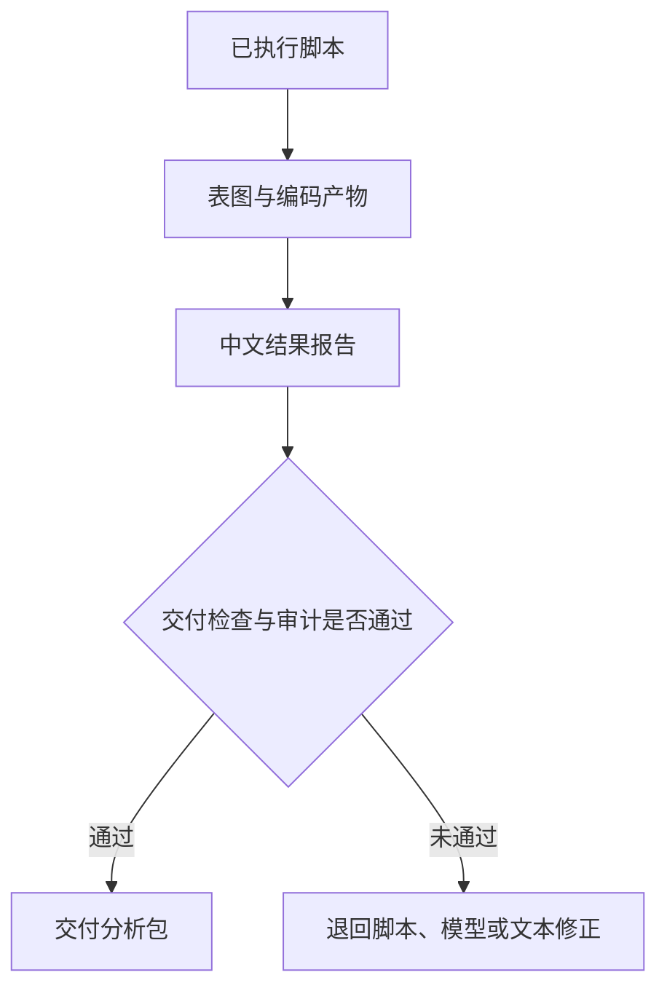

# Phase 06：产物导出、审计核查与交付门控

本阶段的结果报告与检查摘要须遵守 `master/output-protocol.md`，导出、审计与退回链路须附 Mermaid 图及 2–4 条中文解释（说明产物来源、审计状态、退回项与剩余风险）：



## 0. 顾问派发门控

导出成品表图与结果报告前，须派发 `modules/analysis/agents/reporting-consultant.md` 复核呈现规范、统计解释边界、质性摘录呈现与中文结果段落，未通过项须写入 `agent-synthesis-analysis-[YYYY-MM-DD].md` 及 `reports/results-brief.md` 的限制部分。

## 1. 表格导出规范（默认 CSV 论文宽表）

所有描述统计、主回归、非线性/机制/异质性、因果识别、稳健性、质性与混合方法整合表均须默认导出为 CSV（HTML/TeX/DOCX 仅在明确需求或投稿阶段附加，不替代 CSV）。每张表格须可在 `script-index.md` 中追溯至具体生成脚本。

**标准命名**：主文表 `table1-*` / `table2-*` / `table3-*`；附录表 `tableA1-*` / `tableA2-*`；质性表 `qual-table-*`；混合整合表 `joint-display-*`。

### 1.1 回归 CSV 宽表格式

```csv
表4基准回归,,,,
,(1),(2),(3),(4)
因变量A,因变量B,因变量A,因变量B
参考类别（基期）,-,-,-,-
核心解释变量类别1,1.150***,0.119,1.151***,0.115
,(7.494),(0.637),(7.538),(0.616)
控制变量1,-,-,-1.641***,0.487***
,-,-,(-16.525),(6.484)
省份固定,是,是,是,是
观测值,15133,15133,15133,15133
注：*** p<0.01，** p<0.05，* p<0.1，括号内为t值，聚类到家庭层面，下同。,,,,
```

硬性格式要求：
- 第 1 行写中文表题，第 2 行写模型编号 `(1)`–`(N)`，第 3 行写因变量或模型标签；
- 核心变量、机制/调节/异质性变量及**全部控制变量逐行列报**，每变量占两行（系数/边际效应及星号行 + 括号内 t/z 值行），不适用填 `-`；模型特有参数（`cut1`、`常数` 等）保留为普通行；
- 固定效应不展开虚拟变量，以中文行名汇总为「是/否」；表尾保留「观测值」，适用模型输出 `R²` / `调整 R²` / `Pseudo R²` / `Within R²`；
- 标准误类型、聚类层级、权重、参照组与显著性规则写入末尾「注：」行；
- 真实项目表头与变量标签使用 `variable-dictionary.csv` 中的 `display_name`（其次数据标签或清洗后变量名），模板示例保持泛化占位名。

## 2. 图形导出规范

同时保存 PDF（用于论文排版）与 PNG（用于预览），确保坐标轴标签清晰（中英文规范）、边际效应图含置信区间、事件研究图标明政策冲击时点与基准期。

## 3. 中文结果报告结构

`reports/regression-results-[date].md`（或综合结果报告）须包含九个部分：数据与样本、变量与测量、描述统计、模型设定、主结果、稳健性与异质性、质性/文本发现、混合方法整合、限制与不可推断内容。

## 4. 分类型交付前核查清单

- **定量核查**：核心变量存在且类型无误；具备样本流失表与缺失/异常值处理记录；标准误匹配数据结构；系数下方为括号内 t/z 值（线性模型 t、非线性/AME 为 z，无法判定须注明）而非标准误；全部控制变量逐行列报；固定效应以「是/否」汇总；数值保留 3 位小数、样本量与频数保留整数；存在 CSV 宽表；非线性模型已报告 AME 或预测概率；数值与真实运行输出一致且未选择性报告显著结果。
- **质性核查**：原始材料已去标识化；编码本十字段完整；编码片段可回溯匿名原文；具备备忘录与修订记录；内容分析抽样/记录/语境单位清晰；信度指标及分歧处理完整；LLM 辅助编码已核对人工金标准与复核比例；引文无身份泄露风险。
- **混合核查**：定量与质性服务同一研究问题；`joint display` 具整合解释列并明确标注收敛/互补/扩展/分歧；分歧结论未遭隐藏；未以质性摘录装饰定量结论。

## 5. 复现索引、运行日志与 Guard 审计

1. **建立 `reports/script-index.md`**：逐行记录执行顺序、脚本路径、输入数据、输出产物与说明；未执行脚本标注为阻断或模板。
2. **核查 `reports/run-log-[date].md`**：确认每份表图与结果文字均可追溯至真实执行命令（`stata_run_file` / `Rscript` / `python3`），无 `r(...)`、报错或非零退出码，且记录 stdout/stderr 路径与真实输出文件。
3. **执行 `post-bash` 审计与 `score-project` 评分**：读取最新 `paper-workspace/_logs/hook-audit/analysis-log-audit-[date].md`（缺失时先运行审计命令）；若检出报错信号、stdout/stderr 缺失或产物缺失，必须先修复或转入限制段，不得写为已完成结论：

```bash
python3 scripts/paper_master_guard.py post-bash --workspace paper-workspace
python3 scripts/paper_master_guard.py score-project --workspace paper-workspace --json
```

将 `_index/quality-score.md` 中的 `stage_score`、`maturity_score`、分析项得分、失败归因与下一步修复同步写入 `handoff-status.md` 的 `analysis -> write` 交接栏。

## 6. 交付产物结构

`paper-workspace/04-analysis/` 下须至少具备：`data/analysis-data.*`、`data/variable-dictionary.csv`、`tables/table1-descriptives.csv`、`tables/table2-main-regression.csv`、`tables/tableA1-robustness.csv`、`figures/`、`reports/cleaning-report-[date].md`、`reports/model-decision-[date].md`、`reports/regression-results-[date].md`、`reports/script-index.md`。部分完成时须严格区分「已执行产物」与「未执行阻断」。
