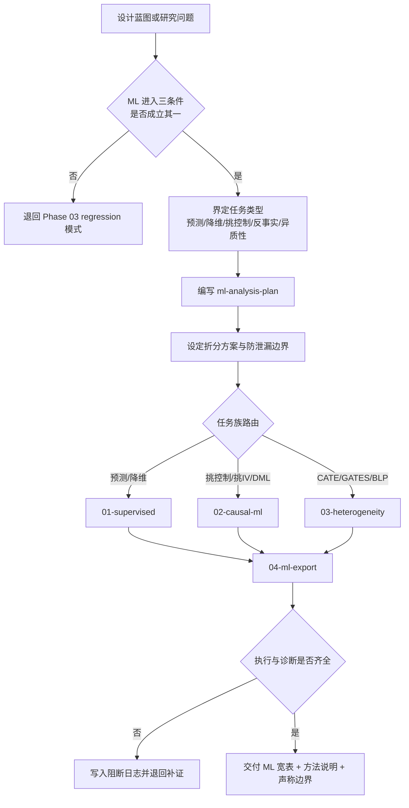

# Phase 07：机器学习与因果 ML

机器学习在本流程中的定位是**修补经典计量或定量方法难以处理的特定薄弱环节**（高维非线性、预测/分类目标、高维控制/工具变量选择或异质性结构探索），不替代识别策略，也不因方法新颖而自动纳入正文。

核心参考为单文件方法库 `references/ml-causal-ml-methods.md`（涵盖方法原理、判据 C24–C31 与报告口径），可执行代码模板位于 `templates/07-ml/`。

## 0. 顾问派发门控

进入 `ml` 模式须先经 `paper-analysis-ml-causal-consultant` 裁决三项核心问题：使用 ML 的具体必要性、切分与防泄漏方案、结果的可声称边界。若无法明确论证上述三项，须退回 `phases/03-basic-regression.md`（`regression` 模式）。

| 需裁决环节 | 派发顾问 | 核心输出内容 |
|---|---|---|
| ML 进入门槛与使用定位 | `ml-causal-consultant`（C24、C25、C30） | 任务类型、进入条件与声称边界 |
| 预测目标、特征集与损失函数 | `analysis-plan-consultant` + `ml-causal-consultant` | `task_id`、变量角色映射与评估指标 |
| PDS / DML / IV 选择的识别假设 | `identification-consultant`（C09、C20、C28） | 正交化对象、控制集与工具外生性 |
| CATE 政策含义与重叠边界 | `identification-consultant` + `ml-causal-consultant`（C29） | 倾向得分重叠、分组依据与政策建议边界 |
| 模板代码撰写 | `code-writer` | 按 `task_id` 单任务输出（语言按 Phase 01 §4） |
| 结果宽表、方法说明与未执行清单 | `reporting-consultant`（C15、C16、C17） | 宽表导出、展示名与阻断清单 |

顾问意见写入 `paper-workspace/_logs/agents/analysis-[YYYY-MM-DD]/` 并汇总至 `agent-synthesis-analysis-[YYYY-MM-DD].md`（须含有效 `参考库回查:` 行）。



关键控制点：`B`（进入门槛）、`F`（折分与防泄漏检查）与 `L`（诊断与实跑验收）未通过时不得推进至下游输出。

## 1. ML 分析计划（`ml-analysis-plan-[YYYY-MM-DD].md`）

保存至 `paper-workspace/04-analysis/reports/`，须包含八项内容：
1. **来源回查**：上游设计、`analysis-execution-plan` 与 `variable-discovery-pack` 依据，及 C24 进入条件论证（三选一）；
2. **任务定义表**：`task_id`、任务类型、目标变量、候选特征、评估指标与入文位置（正文/附录）；
3. **折分与防泄漏方案（C26）**：切分单位（个体 / 最高聚类层级 / 时间点）、训练/验证/测试比例与种子、交叉拟合折数及严格限于训练折内拟合的预处理清单；
4. **超参与搜索空间（C31）**：各模型关键超参、搜索范围与选择规则；
5. **对照与候选模型**：明确包含基准 OLS/Logit 对照、2–3 个 ML 候选模型及不使用深度模型说明（若使用则须说明算力与复现方案）；
6. **计算成本预算**：预计耗时、依赖库、GPU 需求及降规模方案；
7. **可声称边界（C30）**：明确区分预测/重要性指标与因果结论；
8. **退回项**：需退回变量发现或清洗阶段补证的缺口。

## 2. 任务族路由（单 `task_id` 单任务族）

先界定任务族再选定算法；同时兼顾预测与因果异质性的需求须拆分为两个独立 `task_id`。

| 蓝图需求信号 | 任务族 | 对应子流程 | 必报核心表 |
|---|---|---|---|
| 预测结果、风险打分、样本外分类 | 预测（回归/分类） | `01-supervised` | 样本外性能 + 校准 + 变量重要性 |
| 高维变量筛选、缓解多重共线 | 正则化筛选 | `01-supervised`（`regularized`） | 选中变量清单 + λ 路径 + 全控制 OLS 对照 |
| 构建综合指数、潜结构分组 | 无监督结构 | `01-supervised`（`structure`） | 载荷/组内平方和 + 基准解对齐 + 稳定性 |
| 高维控制变量下避免过拟合偏误 | 挑选控制变量 | `02-causal-ml` | 选中控制集清单 + 基准 OLS 并表 |
| 高维工具变量候选筛选 | 挑选工具变量 | `02-causal-ml` | 第一阶段 F + 弱工具检验 + 并表 |
| 政策异质性（CATE）与靶向评估 | 异质性 CATE | `03-heterogeneity` | CATE 分布 + GATES + BLP + 重叠诊断 |
| 汇总导出至论文宽表 | 结果导出 | `04-ml-export` | ML 宽表 + 方法说明 + 未执行阻断清单 |

## 3. 模型决策记录（`ml-model-decision-[task_id]-[YYYY-MM-DD].md`）

每个 `task_id` 在 `reports/` 单独落盘一份决策记录，包含：任务类型与损失函数（C25）、进入条件（C24）、折分方案与种子（C26）、折内拟合边界（C26）、入选与落选模型理由、评估指标（C27）、与基准 OLS/Logit 对照结果、交叉拟合与种子稳定性（C28）、重叠诊断（C29，异质性必填）、可声称与不可声称边界（C30）及复现要素（C31）。

## 4. 脚本目录、参数注意与多语言生态差异

脚本落于 `paper-workspace/04-analysis/scripts/07-ml/` 对应子目录（`01-supervised`、`02-causal-ml`、`03-heterogeneity`、`04-ml-export`）。派发 `code-writer` 遵循 Phase 03 规范，`04-ml-export` 须在前三个子流程完成后执行。

**关键参数注意事项**：
- `02-causal-ml` 的 `iv-lasso` 任务必须通过 `--iv-candidates z1,z2,...` 显式传入工具变量候选列名，未传入时直接阻断并退回变量发现；
- `03-heterogeneity` 的 `--gates-groups` 默认 5 组，当有效样本量小于约 200 时应调整为 3 组，避免组内样本过少失去统计意义。

**Stata 生态口径差异说明（须写入方法说明脚注）**：
Stata 模板仅调用官方命令（`lasso`、`elasticnet`、`pca`、`cluster`、`ivregress`、`bootstrap` 与 Mata 循环），不依赖第三方社区包（`pdslasso`/`ddml`/`rforest`），因此存在以下客观差异：① PDS 采用 Y/X 两方程分别 `lasso linear` 后取并集，不等同于 post-double-selection 推断；② DML 滋扰项固定采用交叉验证 lasso 并按 `$ID` 分组分折，不提供树模型开关；③ 树集成（HistGB/随机森林）与置换重要性仅由 Python/R 版提供，`03-heterogeneity` 因果森林交由 R（`grf`）或 Python 执行，`04-ml-export` 直接使用 Python 或 R 版读取 CSV 导出。

## 5. 必做诊断与退回规则

| 任务族 | 必做诊断 | 不达标处置 |
|---|---|---|
| 预测（回归） | 测试集 RMSE/MAE/R²、残差图、折间波动 | 折间波动大于点估计差异时降级为「无稳定差异」 |
| 预测（分类） | 测试集 AUC、Brier 分数、准确率、校准曲线、阈值敏感性 | 类别不平衡时仅报准确率视为无效 |
| 正则化筛选 | 选中变量清单、λ 路径、与全控制 OLS 并表 | 与核心理论控制集冲突时退回 `identification-consultant` |
| 无监督结构 | 载荷/组内平方和、重抽样稳定性、解数依据 | 稳定性差时仅作结构描述，不作为分类结论 |
| PDS / DML | 选中控制集规模、各折估计、种子稳定性、与基准 OLS 并表 | 无法解释并表差异时不得声称已校正偏误 |
| 挑选工具变量 | 第一阶段 F 值、弱工具检验、过度识别（如适用） | 第一阶段弱时退回 `03-regression/04-causal` |
| CATE 异质性 | CATE 分布、GATES 分位组效应、BLP 检验 p 值、倾向得分重叠诊断 | 重叠不足时仅报组间差异，禁止个体层面政策建议 |

缺失候选特征、分组/时间切分变量、依赖包或算力不足时，立即输出阻断说明与退回任务（变量缺失 -> 变量发现；口径不清 -> 清洗复核；识别失效 -> `identification-consultant`），严禁编写占位代码或未运行结论。

## 6. 执行与防泄漏纪律

1. **测试集单次评估**：超参搜索与预处理仅在训练折内完成，测试集仅用于最终评估一次；
2. **完整记录随机种子**：切分种子、交叉拟合种子与模型随机种子均写入 `run-log-[YYYY-MM-DD].md`，测试换种子后的结论稳定性；
3. **如实记录计算成本**：训练耗时、内存峰值与硬件环境写入运行日志；超出本地算力时按降规模方案重跑并记录。

```bash
# R:
Rscript "paper-workspace/04-analysis/scripts/07-ml/01-supervised/supervised_ml.R" \
  --data "paper-workspace/04-analysis/data/analysis-data.csv" \
  --plan "paper-workspace/04-analysis/reports/ml-analysis-plan-[date].md" \
  --tasks regularized,predict-binary

# Python:
python3 "paper-workspace/04-analysis/scripts/07-ml/01-supervised/supervised_ml.py" \
  --data "paper-workspace/04-analysis/data/analysis-data.csv" \
  --tasks regularized,predict-binary

# Stata (statamcp):
# stata_run_file(file_path="paper-workspace/04-analysis/scripts/07-ml/02-causal-ml/causal_ml.do", working_dir="paper-workspace/04-analysis", timeout=1800)
```

R 侧缺失 `ranger`/`grf`/`xgboost`/`gbm` 等依赖时直接阻断并提示按 `references/r-ecosystem-setup.md` 安装；Stata 包清单见 `templates/_shared/stata-packages.txt` 与 `references/stata-ecosystem-setup.md` §4。

## 7. 输出文件清单

- `reports/ml-analysis-plan-[date].md`、`reports/ml-model-decision-[task_id]-[date].md`、`reports/ml-methods-note-[date].md`、`reports/run-log-[date].md`
- `tables/ml-model-performance.csv`、`ml-calibration.csv`、`ml-variable-importance.csv`、`ml-selected-variables.csv`、`ml-pds-selected-variables.csv`、`ml-regularization-path.csv`、`ml-causal-estimates.csv`、`ml-cate.csv`、`ml-gates.csv`、`ml-blp-test.csv`、`ml-overlap.csv`、`ml-crossfit-folds.csv`、`ml-structure-pca.csv`、`ml-structure-cluster.csv`、`ml-wide-table.csv`、`ml-run-manifest.csv`

结果文字按 `references/quantitative-reporting-standards.md` 撰写，并必须明确陈述「ML 修补的具体薄弱环节」及「预测性能与因果效应各自的可声称边界（C30）」。
