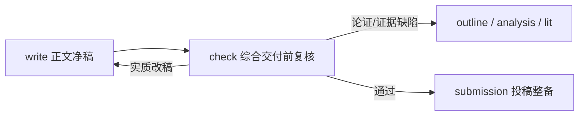

# Paper Check 4SS：全流程审稿与交付前复核

> 参数提示：[稿件路径] [可选: 目标期刊/投稿须知]

本模块在投稿前从编辑初筛、论证闭环、学术诚信与技术规范四个维度执行证据化审稿诊断，生成问题分级矩阵与修改指令，并将实质性问题精确退回对应前置模块。本模块只出具审稿意见与修改清单，不直接覆写稿件：确认改稿后交由 `modules/write/` 执行，Word 版式、引文体例与投稿材料交由 `modules/submission/` 处理。

## 输入定位优先级

1. 用户显式指定的稿件路径；
2. 最新修订稿 `paper-workspace/05-writing/revisions/styled-*.md`；
3. 顶层正文净稿 `paper-workspace/05-writing/manuscript*.md`；
4. 上述路径均不存在时，向用户索取稿件路径。

目标期刊或投稿须知缺失时不阻断通用审稿，但报告须明确标注 `期刊特定核验: 未执行`。缺少引文原文时标注为「待核验」，不得推断违规、虚构错误或给出数值化录用概率。期刊公开要求与参考库通用建议冲突时，以期刊公开要求为准并注明出处。

## 核心审稿框架

### 四层检查维度

1. **编辑首筛**：核查题目、摘要、关键词、引言、创新可见度、可读性与「五感」（标题代入、摘要故事、引言诱导、正文沉浸、结尾共情），模拟首轮初筛判断，不虚构录用率。
2. **论证闭环**：核查「研究问题 -> 标题/摘要/引言 -> 正文结构与证据 -> 结尾」是否闭环；识别三段式、并列式、递进式、对比式或混合式结构，排查十六种常见论证缺陷。
3. **诚信与规范**：核查引文与转引一致性、注释及材料/数据声称边界；缺乏外部核验材料时仅记录核验缺口。
4. **技术与期刊适配**：核查序号、日期、数字、标点、人名、地名、图表、简称及目标期刊硬性要求。

审稿核查围绕「论文闭环」与「七个意识」（产品、规范、敬畏、创新、超越、生命、折旧）展开：问题是否清晰、论点是否回应问题、证据是否支撑论点、结构是否可追踪、结尾是否回收全文而不新增未经论证的声称。

### 问题记录字段与裁决分级

问题矩阵每条记录固定包含：`check_id`、检查维度、原文位置/证据、依据（参考库框架或期刊要求）、严重度、诊断、修改动作、退回模块、复核标准。

严重度三级定义：
- **阻断**：涉及学术诚信、事实/引文错误、核心证据缺失或论证闭环断裂，投稿前必须解决；
- **重要**：显著削弱创新可见度、结构承接、可读性或期刊适配度；
- **优化**：不阻断投稿的表达或技术细节改进。

总体审稿结论限定为四项之一：`可进入投稿整备`、`小修后进入投稿整备`、`大修后复审`、`不建议当前投稿`，且须与问题矩阵严格对应。

## 审稿分工与十维映射

10 维审稿标准、三组核查清单、退回模块与总控路由对应关系如下（`paper-check-reviewer` 须按三组清单逐一核对，不得跳过任何维度）：

| 审稿维度 | 所属检查组 | 问题退回模块 | 总控路由意图 |
|---|---|---|---|
| 选题 / 创新 | A 题摘关键词引言 | `design` / `lit` | 全文审稿 / 拒稿风险 -> `check` |
| 标题 | A 题摘关键词引言 | `write` | 全文审稿 / 编辑首筛 -> `check` |
| 摘要 | A 题摘关键词引言 | `write` | 全文审稿 / 编辑首筛 -> `check` |
| 关键词 | A 题摘关键词引言 | `write` | 全文审稿 / 编辑首筛 -> `check` |
| 引言 | A 题摘关键词引言 | `outline` / `write` | 全文审稿 / 编辑首筛 -> `check` |
| 正文 | B 正文结尾 | `outline` / `analysis` / `write` | 全文审稿 / 论证闭环 -> `check` |
| 结尾 | B 正文结尾 | `write` | 全文审稿 -> `check` |
| 引文注释 | C 引文技术规范 | `lit` / `submission` | 全文审稿 / 诚信规范 -> `check` |
| 技术规范 | C 引文技术规范 | `submission` | 全文审稿 -> `check`；仅 Word/体例 -> `submission` |
| 投稿适配 | A 题摘关键词引言 | `submission` | 全文审稿 / 期刊适配 -> `check`；仅投稿包 -> `submission` |

本模块不负责语言润色/扫描（归 `write`）及项目成熟度打分（归总控 `score-project`）。

## 输出产物与退回流程

在 `paper-workspace/05-writing/reviews/` 下输出三份文件：

```text
paper-check-report-[slug]-[YYYY-MM-DD].md
paper-check-matrix-[slug]-[YYYY-MM-DD].md
paper-check-revision-list-[slug]-[YYYY-MM-DD].md
```

- **主报告**：包含输入信息、审稿限制、总体结论、关键阻断项、10 维结论及退回路径 Mermaid 图；
- **问题矩阵**：逐条记录检查证据与退回目标；
- **修改清单**：按「阻断 -> 重要 -> 优化」排序并附复核标准。

完整审稿须派发 `paper-check-reviewer` 并等待其返回终态，三组清单在同一份顾问意见内完成，综合报告写入 `paper-workspace/_logs/agents/check-[YYYY-MM-DD]/agent-synthesis-check-[YYYY-MM-DD].md`。若仅执行单项维度检查，须在报告中注明未覆盖维度及原因。



退回与复核规则：
- `check` 不替代前置模块补建证据，也不替代 `submission` 执行 Word 导出与投稿包组装；
- 存在阻断项时优先退回对应模块修订，修订完成后依据原 `check_id` 与复核标准复审；
- 执行 `check` 属于质量复核门控，不单独新增论文阶段。

## 执行阶段与顾问协议

依次读取 `phases/01-intake-and-routing.md`、`phases/02-layered-review.md`、`phases/03-synthesis-and-return.md`。完整审稿同步读取 `agents/reviewer.md`（`paper-check-reviewer`）。

顾问意见开头须回填 `参考库回查:`（`base=check-2026.10.24` + `tier=T2` + 判据条目号 + 缺口），并逐条引用 `chapters/`、`patterns.md` 或 `cheatsheet.md` 条款；最终严重度由主流程裁决，意见分歧与未采纳理由保留于综合文件。

## 章节与主题索引

| 章节文件 | 对应主题 |
|---|---|
| [ch01](chapters/ch01-outline-selection-design-writing.md) | 选题、设计、撰写与七个意识 |
| [ch02](chapters/ch02-title.md) | 标题 |
| [ch04](chapters/ch04-abstract.md) | 摘要 |
| [ch05](chapters/ch05-keywords.md) | 关键词 |
| [ch06](chapters/ch06-introduction.md) | 引言 |
| [ch07](chapters/ch07-body.md) | 正文与论证（含十六种常见缺憾） |
| [ch08](chapters/ch08-conclusion.md) | 结尾 |
| [ch09](chapters/ch09-notes-and-references.md) | 注释与参考文献 |
| [ch10](chapters/ch10-technical-standards.md) | 技术规范 |
| [ch12](chapters/ch12-submission.md) | 投稿与期刊适配 |

辅助参考：[glossary.md](glossary.md)、[patterns.md](patterns.md)、[cheatsheet.md](cheatsheet.md)。
