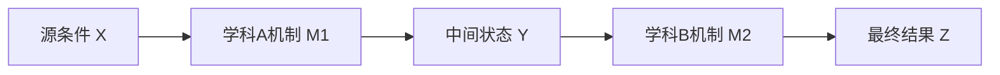

# Phase 02：STORM 模式 — 跨学科理论嫁接与选题生成

进入本阶段前须已确认工作模式与研究取向（`research_orientation`）；若取向为「尚未确定」，不得输出正式 Top 10 研究问题。

候选问题生成与评估须依据已确认取向执行：
- **实证取向**：要求变量、数据与识别策略可检验；
- **概念/解释取向**：评估概念增益、解释力与竞争理论区分度；
- **规范取向**：评估评价标准、原则冲突与反例承受力；
- **阐释取向**：评估文本边界、历史语境与竞争诠释比较；
- **混合取向**：明确主次路径分工与互证机制。

## 触发条件

- 用户选择 `storm` 模式，或以「头脑风暴」「跨学科选题」「理论嫁接」「创新选题」为目标；
- `FULL` 模式第二阶段；
- 学科路由同时命中 2 个及以上学科时建议执行。

## 输入要求

| 字段 | 是否必需 | 说明 |
|---|---|---|
| 研究主题 | 是 | 具体研究现象或学术问题 |
| 关联学科 | 是 | 2–3 个相关学科 |
| 目标期刊 | 推荐 | 校准选题贡献与篇幅适配 |
| 数据/材料来源 | 推荐 | 评估研究问题可行性 |
| FRAME 报告 | 否 | 若已生成，作为本阶段起点 |

## 执行流程

### Step 1：多学科框架加载

提取 3–8 个跨学科定位关键词并运行初筛脚本取得 Top 2–3 候选框架与 `read_ranges`（输出写入过程日志及顾问输入包）：

```bash
python3 scripts/frame_locator.py --topic "[研究主题]" --keywords "[关键词，空格分隔]" --top 3
```

按 `read_ranges` 执行 `sed -n '[start],[end]p' frame/theory-frameworks-[discipline].md`（每个候选学科至少读取 Top 3 个区间），提取各学科相关理论的核心主张、机制链条、证据强度、理论地位与竞争/互补关系；仅在跨学科证据不足时扩展相邻行号区间。

### Step 2：跨学科四维交叉扫描

在 2–3 个学科间执行四维交叉扫描：
1. **概念同构**：识别不同学科以不同术语描述相近社会机制的对应概念（输出概念 A/B、同构逻辑、深层机制、可操作性）。
2. **机制互补**：串联两学科机制形成完整因果链，并按 `master/output-protocol.md` 绘制 Mermaid 链条图及附 2–4 条中文解释：



3. **理论冲突**：识别两学科对同一现象的相反预测，定位关键调节条件与竞争假设（`H_A vs H_B`）。
4. **方法迁移**：识别学科 A 的成熟方法或分析工具如何迁移以解决学科 B 的理论命题（阐明迁移优势与适配条件）。

### Step 3：理论嫁接方案设计

依据扫描结果设计 3–5 个跨学科嫁接方案（或非实证路径下的概念重构、规范悖论、谱系重读与语境冲突整合方案）：

| 嫁接策略 | 核心操作 | 主要风险 |
|---|---|---|
| **概念移植** | 将学科 A 的概念工具引入学科 B 现象解释 | 跨语境概念漂移 |
| **机制串联** | 串联两学科机制构成完整传导链 | 中介衔接断裂 |
| **边界重划** | 用学科 B 的发现限定学科 A 理论的适用边界 | 边界过窄削弱普适性 |
| **方法迁移** | 用学科 A 方法检验学科 B 理论命题 | 方法前提与现象本体不匹配 |
| **反事实挑战** | 用学科 A 反直觉机制修正学科 B 既有共识 | 挑战机制缺乏替代解释排除 |

每个嫁接方案须包含：策略类型、源理论 A/B、嫁接逻辑（≤ 150 字）、1–3 条新理论命题、创新性评估（是否超越单一学科/提供新机制或概念）、可检验性或材料可支撑性评估，以及目标期刊匹配度与潜在审稿人关切。

### Step 4：生成 15–20 个候选研究问题（RQ / 中心论题）

综合运用以下策略生成 **15–20 个候选 RQ**（覆盖至少 4 种策略）：
- **A. 理论驱动**：从嫁接核心命题直接推导；
- **B. 机制驱动**：聚焦因果链条中的关键中介环节；
- **C. 冲突驱动**：围绕两学科竞争预测设计裁决问题；
- **D. 边界驱动**：围绕理论成立的制度/结构边界条件发问；
- **E. 情境驱动**：将既有理论置于特定制度、数字化或危机转型情境检验修正；
- **F. 方法/材料驱动**：依托特定面板、自然实验、档案或田野优势检验既定命题；
- **G. 非实证拓展（按取向启用）**：概念重构、规范原则悖论、理论谱系重读或文本语境冲突。

每条候选 RQ 须列明：问题陈述（1–2 句）、理论嫁接来源、核心分析元素（实证填 `X/Y/M/W`，非实证填核心概念/标准/文本范围）、生成策略、预期贡献类型、初步可行性与创新性评估。

### Step 5：风险驱动的多视角评估与综合

按 `master/agent-orchestration.md` 创建或更新 `paper-workspace/_logs/agents/design-[YYYY-MM-DD]/agent-brief.md` 与 `agent-synthesis-design-[YYYY-MM-DD].md`。依据当前选题的实质风险（理论冲突、方法可行性、共同体定位、期刊适配或致命缺陷）从 `design` 模块顾问中选派最少必要角色（无需固定派满 5 人；无并行能力时按序复核并记录 `sequential-review`）。

派发前主流程须预先读取对应参考文件内容（`frame/` 指定行号区间、`references/storm-patterns.md`、`references/method-feasibility.md`、`references/design-essence.md`、`phases/05-quality-gates.md`、`master/output-protocol.md`）并嵌入 prompt 末尾的 `## 参考库内容（主流程已预注入）` 段落。

评估围绕六个维度（1–10 分）展开：理论创新性、嫁接合理性、可检验性/可论证性、发表潜力、数据/材料可行性、社会/学术意义，形成多视角共识评分卡并标记致命缺陷（`FATAL FLAW`）。

### Step 6：RQ 精炼与致命缺陷清理

1. 对共识度 ≥ ★★★ 的候选 RQ，依据评审意见进行措辞操作化、界定范围条件、强化概念桥梁或替换材料来源；
2. 凡被判为 `FATAL FLAW`（逻辑矛盾、同义反复、不可操作/不可论证、数据/材料根本不存在、违反伦理或纯表面类比）的候选 RQ 须移出 Top 10；
3. 输出「原始版本 vs. 精炼版本」对照表。

### Step 7：输出 STORM 报告与日志

保存至 `paper-workspace/01-design/storm-report-[slug]-[date].md`，须包含八章：
1. 研究主题与多学科定位；
2. 跨学科交叉扫描矩阵（四维度）；
3. 理论嫁接方案（3–5 个）；
4. 全部候选 RQs（15–20 个，按策略分组）；
5. 评估共识评分卡与分歧/FATAL FLAW 处理记录；
6. 精炼后的 Top 10 RQs（含理论来源、核心要素、贡献类型、可行性与发表潜力）；
7. 分梯队推进建议（Quick-Win / Medium-Investment / Deep-Investment）；
8. 下一步建议（进入 DESIGN 模式）。

同步写入 `paper-workspace/_logs/process-log-design-[YYYY-MM-DD].md`。

## STORM 质量自检

- [ ] 交叉扫描覆盖 ≥ 2 个学科，且完成 ≥ 2 个扫描维度
- [ ] 每个嫁接方案明确标注策略类型，并具创新性与可行性双维评估
- [ ] 15–20 个候选 RQs 覆盖 ≥ 4 种生成策略，要素完整
- [ ] 顾问派发符合风险驱动原则（或记录 `sequential-review` / `agent-skip`）并已更新 `agent-synthesis`
- [ ] 已清理全部 `FATAL FLAW` 项，Top 10 RQ 附精炼对照说明
