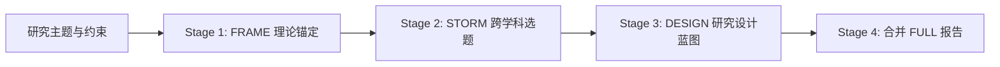

# Phase 04：FULL 模式 — 端到端全流程执行

进入 `FULL` 模式前须已锁定工作模式与研究取向（混合取向另须明确主次路径与互证关系），该选择贯穿 Stage 1 至 Stage 3。

各阶段顾问按当前实质风险选派最少必要角色（不预设固定名单）；无并行能力时采用顺序复核并记录 `sequential-review`，轻量环节记录 `agent-skip`。各阶段门控依据已确认的研究取向验收（理论、规范与阐释路径不强制变量、功效或回归设定）。

## 触发条件

- 用户选择 `full` 模式，或要求完成从理论锚定到研究设计蓝图的全套设计方案。

## 全流程阶段架构



说明：Stage 1 产出单学科理论定位与空白清单；Stage 2 产出跨学科嫁接与 Top 10 RQs；Stage 3 将选定 RQ 转化为研究设计蓝图；Stage 4 汇总全部产物并确定下游是否进入 `analysis`。任一 Stage Gate 未通过时须在当前阶段修正后再进入下一阶段。

## 执行流程

### Stage 0：模式锁定与初筛

确认记录 `mode-lock: FULL` 与 `research_orientation` 后，提取 3–8 个定位关键词并运行：

```bash
python3 scripts/frame_locator.py --topic "[研究主题]" --keywords "[关键词，空格分隔]" --top 3
```

将关键词、候选框架、相关度分数、命中词与 `read_ranges` 写入过程日志，作为 Stage 1 与 Stage 2 路由依据。

### Stage 1：理论框架探索（执行 `phases/01-frame-mode.md`）

1. 完成学科路由与 `read_ranges` 读取；
2. 完成理论定位矩阵（≥ 5 个候选理论）与研究空白清单（≥ 5 项空白）；
3. 输出 `paper-workspace/01-design/frame-report-[discipline]-[slug]-[date].md`。

**Stage Gate 1**：FRAME 报告六章完整、候选理论与研究空白数量达标、推荐方向有明确理论根基。

### Stage 2：跨学科选题与评估（执行 `phases/02-storm-mode.md`）

1. 基于 Stage 1 成果执行多框架加载与四维交叉扫描；
2. 设计 3–5 个嫁接方案并生成 15–20 个候选 RQs；
3. 按需派发顾问评估并清理 `FATAL FLAW` 项，精炼 Top 10 RQs；
4. 输出 `paper-workspace/01-design/storm-report-[slug]-[date].md`。

**Stage Gate 2**：交叉扫描覆盖 ≥ 2 个学科、顾问评估与 `agent-synthesis` 已记录、致命缺陷已清除、Top 10 RQs 要素完整。

### Stage 3：研究设计蓝图（执行 `phases/03-design-mode.md`）

1. 从 Top 10 RQs 中经用户确认选定 1–2 个核心问题；
2. 按已确认 `research_orientation` 生成研究设计、七项对齐检查与下游边界；
3. 输出 `paper-workspace/01-design/design-report-[slug]-[date].md`。

**Stage Gate 3**：设计报告完整、理论—方法七项对齐无未处理的「不通过」项、稳健性或竞争反驳方案完备。

### Stage 4：合并完整方案与下游交接

将三阶段产物整合为 `paper-workspace/01-design/full-report-[slug]-[date].md`，结构涵盖：
- **第一部分（FRAME）**：研究主题与学科定位、框架总览、理论定位矩阵、研究空白、推荐方向；
- **第二部分（STORM）**：交叉扫描矩阵、理论嫁接方案、评估共识、精炼后 Top 10 RQs；
- **第三部分（DESIGN）**：理论锚点与机制链、研究设计概览、操作化/概念与材料方案、模型或论证设定、对齐检查、稳健性/竞争反驳方案与执行边界；
- **第四部分（路线与交接）**：`research_orientation`、`analysis_required`（仅 `true` 时交接 `analysis`，否则交接 `lit` -> `outline` -> `write`）、关键风险与下一步建议。

## 阶段推进确认与跳过规则

遵循研究者主导权覆盖规则：在 Stage Gate 1 与 Stage Gate 2 处向用户汇报阶段产出并确认后再推进下一阶段（除非用户在启动时明确授权连续执行至合并）。

若用户已有可追溯的上游成果，可按需跳过对应阶段（须写明依据并保留 `mode-lock`）：
- `--skip-frame`：仅当用户提供可追溯的理论框架与 `frame/` 出处时允许；
- `--skip-storm`：仅当用户提供既定候选 RQs、理论嫁接来源与评估依据时允许；
- `--design-only`：仅当理论锚点、核心 RQ、材料与方法偏好均已具备时允许。

## FULL 质量自检

- [ ] 三阶段分报告与合并 `full-report` 均已保存，且首部标明 `research_orientation` 与 `analysis_required`
- [ ] 每个 Stage Gate 均已通过并记录于过程日志
- [ ] 从理论框架 -> 嫁接方案 -> RQ -> 研究设计保持全链路名称与口径一致
- [ ] 下游交接路径与研究取向严格匹配
