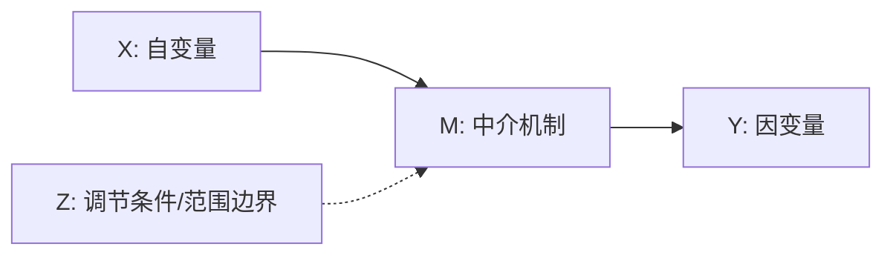

# Phase 3：理论框架与假设推导（仅模式 D）

本阶段仅在模式 D 下加载，从 Phase 2 识别的文献空白出发，选定理论框架、界定机制链条并推导可检验假设。

## 顾问派发门控

进入推导前，须派发 `modules/lit/agents/hypothesis-bridge-consultant.md` 核查「空白 -> 理论 -> 机制 -> 假设」的逻辑连贯性，并将意见写入 `paper-workspace/_logs/agents/lit-[YYYY-MM-DD]/hypothesis-bridge-consultant.md` 及 `agent-synthesis-lit-[YYYY-MM-DD].md` 后方可定稿假设。

---

## 3a. 理论框架评估与加载

1. 读取索引 `modules/lit/references/theory-frameworks.md`，依据关键词匹配 1–3 个核心学科；
2. 按需读取对应 `modules/design/frame/theory-frameworks-[discipline].md`（跨学科时主学科精读、辅助学科按章节定位读取）；
3. 对比本领域常用基线框架与跨传统框架（至少包含 1 个来自不同传统的框架），按六维度（核心主张、机制链条、实证支持度、竞争框架、关键论文、理论地位）评估适配度。

| 框架 | 对空白的核心预测 | 机制链条 | 实证支持度 | 竞争框架 | 适配度 | 适配/不足原因 |
|---|---|---|---|---|---|---|

## 3b. 框架选择与论证定位

选定 1 个主框架（至多 1 个辅助框架），围绕三点构建论证（细节见 `modules/lit/references/gap-to-hypothesis.md`）：
1. **空白匹配**：指明该框架如何直接回应 Phase 2h 中的具体空白类型；
2. **竞争框架局限**：说明 1–2 个竞争框架在该具体问题上的不足；
3. **推进方式**：界定属于理论应用、边界条件检验还是理论整合/拓展。

## 3c. 机制阐释与 Mermaid 图示

按「`[X]` 导致 `[Y]`，是因为 `[机制 M]` 通过 `[过程 P]` 在 `[范围条件 C]` 下运作」界定机制，标明机制类型（资源/物质、网络/关系、制度/行政、文化/认知、心理、空间）及人群、情境、阈值三类范围条件。

按 `master/output-protocol.md` 绘制 Mermaid 机制图并附 2–4 条中文解释（说明节点文献依据、机制类型与证据缺口）：

## 3d. 假设推导与可追溯链表

提出 2–4 条具理论根基、方向明确、可证伪且非常识化的研究假设，并完成**推导链表**（任一列无法填写则该假设未落地，须补证或放弃；支撑文献须为 `paper-registry.csv` 中 `reading_status=read` 且具全文页码/章节定位的条目，纯摘要仅可支持方向预期而不支撑机制链接）：

| H# | 文献空白（来自 2h） | 空白类型 | 框架预测（来自 3b） | 机制链接（来自 3c） | 正式假设陈述 |
|---|---|---|---|---|---|

常用假设形式：主效应（`H1`）、中介/机制检验（`H2`）、调节/异质性边界（`H3`）、竞争预测（`H4` vs `H4'`）。另汇总「假设编号—陈述—方向—对应空白—理论依据—机制链接」总表。

## 3e. 替代解释与区分设计

| 假设 | 主预测 | 竞争/替代预测 | 研究设计如何区分 |
|---|---|---|---|

同时拟定 1–2 项针对主要混杂因素的稳健性检验思路。

## 3f. 按目标期刊选择假设呈现方式

| 目标期刊类型 | 呈现模式 | 说明 |
|---|---|---|
| `ASR` / `AJS` / `管理世界` 等 | 融合式 | 在主题文献子节内交织文献梳理、理论推导与假设提出 |
| `Demography` | 分离式（≥ 3 条假设时融合式） | 集中于独立概念框架节 |
| `NHB` / `Science Advances` | 分离式预测 | 采用自然语言研究预测，不编号 `H1`/`H2` |
| 语言学/部分质性期刊 | 整合 RQ 式 | 将理论预期融入综述子节，以「The Present Study」收尾 |

最终产出保存至 `paper-workspace/02-literature/hypothesis-derivation.md`（非实证路径按取向并入理论对话材料），供 `outline` 与 `write` 下游承接。
