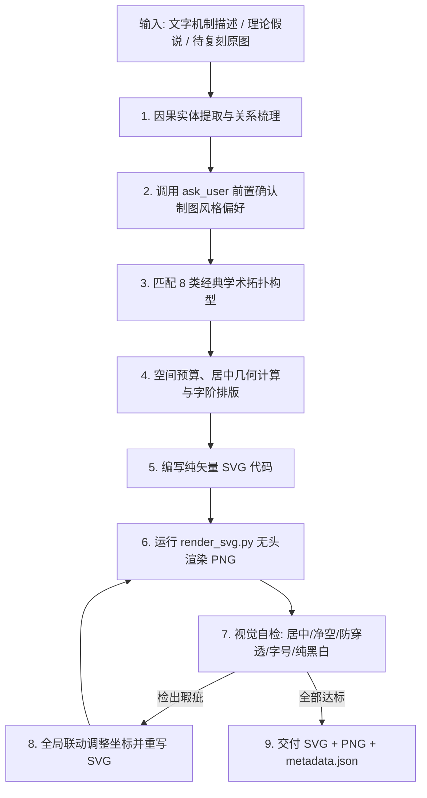

# Paper Mechanigraph 4SS：社科学术机制图纯矢量设计引擎

> 参数提示：[机制描述文字 / 理论假说] 或 [待复刻原图路径] [可选: 风格偏好]

本模块负责将文字机制描述、理论假说或已有机制图草图转化为符合 CSSCI/SSCI 黑白印刷标准的纯矢量 SVG 学术机制图，并通过无头 Chrome 渲染 PNG 执行视觉自检与坐标修正，直至全部排版规范达标。

核心原则：图面仅保留白底、纯黑线条与规范字体；主标题、图注、数据来源与作者信息留由正文排版承担，不写入图内。

## 上下游协同定位

- **承接 `design`**：在理论锚点确定后，将核心概念与命题关系转化为理论分析框架图；
- **承接 `analysis`**：在回归、中介、调节或过程追踪完成后，将经验因果链转化为实证机制图；
- **交付 `write`**：将矢量产物及元数据移交正文排版，并附规范插图引用与图题建议；
- **统一归档**：产物输出至 `paper-workspace/figures/`，纳入 `scripts/paper_master_guard.py` 产物检查与质量评分。

## 内置顾问角色

本模块包含两个顾问角色（协议见 `agents/`，执行身份以 `references/agent-registry.md` 标准名为准）：
1. **`paper-mechanigraph-topology-consultant`**：从文本或假说中提取因果实体，匹配 8 类经典学术拓扑构型，并拟定出图前风格询问项。
2. **`paper-mechanigraph-svg-designer`**：执行空间几何计算、编写纯矢量 SVG、配置字阶与防穿透排版，并运行无头 Chrome 渲染 PNG 完成视觉自检修正。

## 运行能力映射

按 `references/runtime-adapter.md` §5 探测结果映射真实工具（形态对照见 `references/agent-software-adapters.md` §1）：
- **`ask_user`**：出图前确认构型流派、外围边框与连线分箱风格；
- **`read_file` / `write_file`**：读取输入与样例规范，输出 SVG / JSON 文件；
- **`run_shell`**：调用 `scripts/render_svg.py` 生成 PNG 预览图用于视觉自检。

## 默认输出路径

在 `paper-master-4ss` 工作区下执行时，产物路径固定为：
- **矢量主图**：`paper-workspace/figures/mechanism-[slug]-[date].svg`
- **渲染预览图**：`paper-workspace/figures/mechanism-[slug]-[date].png`
- **元数据记录**：`paper-workspace/figures/mechanism-metadata-[slug]-[date].json`

独立运行或原图复刻模式下未指定工作区时，输出至用户指定路径或当前目录 `figures/`。

---

## 标准制图工作流



---

## 一、制图前风格确认（前置必做）

编写 SVG 代码前，必须先确认制图风格偏好（已由用户显式指定则直接采纳并在元数据中记录）：

- **具备 `ask_user` 能力时**：一次性询问以下三项偏好；
- **缺失 `ask_user` 能力时**：在单轮回复中一次性列明问题与推荐默认项，并记录 `ask_user=能力缺失`。

标准询问项（示例结构见 `references/user-question-examples.md` 六）：
1. **拓扑构型流派**：`自动匹配`（从 8 类经典拓扑自动匹配）或指定经典构型（如流水线时序模型 / 纵向层级架构 / 双系统对偶模型 / 多主体网络等）；
2. **外围大边框样式**：`实线大外框`（经典期刊出版风）/ `虚线大外框`（开放系统边界）/ `无外围边框`（极简无外框）；
3. **分箱与连线风格**：`实线为主` / `虚实结合`（核心实体与主路径实线，环境分箱、调节变量与反馈线虚线）。

---

## 二、十六项制图规范（硬性要求）

### 1. 禁止图内主标题与边角说明
- 严禁在图内绘制「图1 XXX机制图」等主标题（图标题由正文排版承担）；
- 严禁在图内写入「作者自制」「数据来源」等注释字样。

### 2. 字体栈与字阶规范（黑体 + 加粗仿宋）
- **核心强调项（主模块、核心概念、一级标签）**：使用标准黑体且不强制加粗（`font-weight="normal"`），通过大字号（`20px ~ 24px`）形成视觉层级；字体栈：`'SimHei', 'Heiti SC', 'Microsoft YaHei', sans-serif`。
- **次级非强调项（次级节点、括号指标、连线标注、细分参数）**：使用加粗仿宋体（`font-weight="bold"`），字号 `14px ~ 16px`；字体栈：`'FangSong', 'STFangsong', 'FangSong_GB2312', 'SimSun', serif`。
- **英文与数字**：`'Times New Roman', 'Arial', sans-serif`。

### 3. 纯白底黑字配色规范
- 严禁使用任何彩色、深色/黑色背景块（禁止文字反白）或浅灰底色填充（如 `#f5f5f5`、`#eeeeee`、`#333333`）；
- 所有容器与卡片填充统一为纯白 `fill="#ffffff"` 或透明 `fill="none"`；
- 所有文字统一为纯黑 `fill="#000000"`；所有线条与边框统一为纯黑 `stroke="#000000"`。

### 4. 动态画布尺寸与像素视口 1:1 绑定
- 按构型复杂度选择匹配画布比例，禁止单一比例套用所有图形：
  1. **标准 3:2 画布（`900 × 600` ~ `960 × 640`）**：常规 4–6 节点动力学、网络或对偶模型；
  2. **大型三元/综合架构（`1320 × 720`）**：左起点 + 中部复合机制 + 右产出 + 底部反馈回路；
  3. **宽幅长时序链（`1200 × 650` ~ `1400 × 750`）**：5–7 阶段横向流水线；
  4. **纵向深层级架构（`900 × 1000` ~ `1000 × 1200`）**：4–6 层宏—中—微纵向框架；
  5. **正方环形网络（`800 × 800` ~ `900 × 900`）**：正多边形主体网络、同心圆或矩阵。
- SVG 根元素须严格声明 `<svg xmlns="http://www.w3.org/2000/svg" viewBox="0 0 {W} {H}" width="{W}" height="{H}">`，严禁使用 `width="100%" height="100%"`。
- 外围大边框按四向对称公式 `<rect x="{P}" y="{P}" width="{W - 2*P}" height="{H - 2*P}" rx="8" />` 定位（`P = 35px ~ 40px`），核心元素以 `(W/2, H/2)` 为基准对称居中展开。

### 5. 曲线净空与防穿透
- 跨实体的全局演进曲线或反馈回路，轨迹与下方卡片顶部保持至少 `35px ~ 50px` 净空，严禁横切文字或穿过卡片；
- 阶梯间传导采用正交折线（`M x1 y1 L x2 y1 L x2 y2 L x3 y2`）精确停靠边界。

### 6. 文字与图形元素间距
- 卡片内边距保持 `12px ~ 20px`；
- 水平连线标注与线条保持 `8px ~ 12px` 垂直间距；
- 斜线与曲线上方标注文字（以文字包围盒最邻近拐角计）与曲线保持至少 `25px ~ 40px` 净空；
- 多行文本垂直行距保持 `22px ~ 28px`。

### 7. 实体间物理间隙
- 相邻卡片、圆形节点与分箱之间保留 `20px ~ 45px` 间隙（严禁圆形外环直接相切或紧贴卡片边缘）；
- 水平并列卡片间距保持 `30px ~ 45px`；分箱内边距 ≥ `20px`；外大边框与内部最外缘元素保持 `35px ~ 45px` 安全留白。

### 8. 全局分层空间预算
- 复杂演进图须划分为互不干扰的水平高度带（顶部趋势带、中部实体带、底部基线带）；修改任一元素高度时须联动调整关联卡片、连线与基线坐标，避免局部微调破坏全局平衡。

### 9. 连线侧边标注显式对齐
- 竖直或倾斜连线两侧标注不得使用默认 `text-anchor="middle"`：左侧文本显式声明 `text-anchor="end"`，右侧文本显式声明 `text-anchor="start"`，X 坐标距连线保持 ≥ `12px` 间隙。

### 10. 纵向实体间距
- 纵向排列且中间含双向箭头及文字标注的实体卡片，纵向净空不得小于 `70px`；箭头起止端距卡片边框保留 `6px ~ 8px` 衬垫，严禁撞击或穿透边框。

### 11. 跨系统长连线与文字走廊
- 跨系统连线须完整连接源实体边缘与目标系统边界，严禁中途悬空；
- 跨系统标注文字须置于两系统间空旷走廊中央，距任一容器边界保持 ≥ `35px` 净空，避免被分箱边框线横切。

### 12. 单向箭头终点化与双向平行双线
- 单向连线仅在终点使用 `marker-end="url(#arrow)"`，严禁在起点添加 `marker-start`；
- 双向交互须绘制两条平行单向箭头线（各自仅在终点带箭头），标注分列左右。

### 13. 左右双系统横向配平
- 包含左右对偶系统的架构图，左右两系统外边缘距外大边框的横向距离误差须控制在 ±`5px` 以内，内部主轴各自对齐所属子系统几何中心。

### 14. 文本宽度校验防溢出
- 按 `W_text ≈ N × S`（N 为中文字符数，S 为字号 px）估算文本宽度，须满足 `W_text + 2 × Padding_safe ≤ W_container`（`Padding_safe ≥ 25px`）；超宽时按需折行或微调字号（13.5–14px）。

### 15. SVG 语法与字符安全
- 严禁在 XML 注释（`<!-- ... -->`）中出现连续双减号 `--`（注释内使用 `=` 或单 `-`）；
- 生成代码中不使用未转义反斜杠，箭头及符号直接使用原生 Unicode 字符（如 `→`、`·`、`〔 〕`、`①`）。

### 16. 连线图层顺序与徽标避让
- 跨层连线绝对禁止穿过容器顶部的标题徽标矩形或文字，终点须停靠外边框或空旷走廊；
- SVG DOM 中连线须声明在目标卡片、背景矩形及文字之前，利用实体白底（`fill="#ffffff"`）自然遮挡底层穿行线段。

---

## 三、渲染与视觉自检流程（交付前必做）

每次生成或修改 SVG 后，均须执行无头渲染并对照清单逐项视觉复核：

```bash
python3 modules/mechanigraph/scripts/render_svg.py <file.svg> <file.png>
```

核查清单（任一项不通过须联动修正坐标并重跑渲染）：
1. 整体是否以画布为中心对齐，四向留白是否对称（≥ `35px`）？
2. 顶部、中部、底部高度带是否清晰分离且互不重叠？
3. 是否存在连线横切文字或穿透卡片边界的情况？
4. 跨层连线是否避开标题徽标且端点精确停靠外缘？
5. 斜线/曲线上方标注拐角是否保持 ≥ `25px` 净空？
6. 相邻实体间是否留有 `20px ~ 45px` 间隙（无相切或贴边）？
7. 全图是否严格纯黑白（无彩色、无灰底、无反白）？
8. 图内是否混入主标题（「图1 XXX」）或作者注释？
9. 字阶是否符合规范（主概念大号不加粗黑体，次级项加粗仿宋）？

---

## 四、模块参考文件与脚本索引

- **8 类构型几何样板**：`references/drawing_patterns_reference.md`
- **坐标与防穿透数学规范**：`references/design_system.md`
- **经典期刊拓扑分类名录**：`references/layout_catalog.md`
- **标准矢量箭头组件**：`resources/academic_defs.svg`
- **无头渲染脚本**：`scripts/render_svg.py`（支持 Chrome CLI 与 Selenium 双模式）
- **标准机制图样例**：`examples/`（8 份 CSSCI/SSCI 级纯矢量 SVG 样例）
