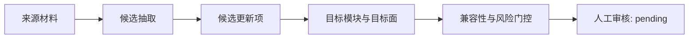

# Phase 06：待审核更新包交付

## 顾问派发门控

输出更新包前须由 `modules/update/agents/review-gate-consultant.md` 最终复核来源、证据等级、目标位置、风险等级、验证方式、`pending` 状态与人工审核清单（`self-update` 候选须具备 `target-routing` 与 `review-gate` 双重审核记录）。未通过项须写入 `agent-synthesis-update-[YYYY-MM-DD].md`、`review-checklist-[slug]-[date].md` 及最终回复。

## 目标与图示要求

生成完整的待审核更新包、审核清单与人工合并说明，严禁修改任何核心模块文件，所有候选保持 `pending`。文件须遵守 `master/output-protocol.md`，在报告中附候选流转 Mermaid 图及 2–4 条中文解释（说明来源、候选、目标位置、证据等级、风险等级与审核风险）：



## 标准交付目录

```text
paper-workspace/07-update/
├── update-report-[slug]-[date].md
├── review-checklist-[slug]-[date].md
├── proposed-diffs/
│   ├── knowledge/
│   ├── workflow/
│   ├── agents/
│   ├── templates/
│   ├── scripts/
│   └── self-update/
├── evidence/
└── merge-instructions-[slug]-[date].md
```

## 交付文件模板

### `update-report-[slug]-[date].md`

```markdown
# Update Report

## Summary
- Purpose:
- Source:
- Candidate count:
- Review status: pending
- Contains self-update: true/false

## Candidate Targets

| Candidate ID | Purpose | Target module | Target surface | Target file | Suggested location | Risk tier | Required validation | Evidence file | Review status |
|---|---|---|---|---|---|---|---|---|---|

## Notes
- Not merged.
- Requires human review.
- High-risk candidates require manual validation before merge.
```

### `review-checklist-[slug]-[date].md`

```markdown
# Review Checklist

| Candidate ID | Source clear | Evidence adequate | Target correct | Risk tier set | Validation adequate | Self-update double review | Decision |
|---|---|---|---|---|---|---|---|
| C001 | pending | pending | pending | pending | pending | pending/not-applicable | pending |
```

### `merge-instructions-[slug]-[date].md`

```markdown
# Merge Instructions

Do not apply automatically.

For each accepted candidate:
1. Open target file.
2. Locate suggested heading.
3. Insert or adapt candidate content.
4. If risk tier is medium/high, run the listed validation.
5. Record reviewer, date, decision, validation result, and any rollback notes.
```

最终回复仅报告待审核更新包输出路径与审核状态，严禁声称已合并生效。
